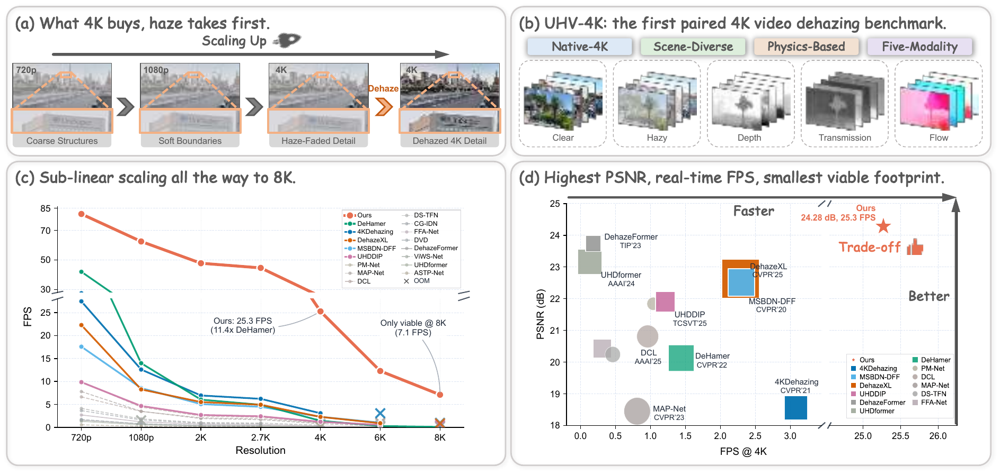

<div align="center">

<h1>🌫️ LiBrA-Net: Lie-Algebraic Bilateral Affine Fields for Real-Time 4K Video Dehazing</h1>

<hr>

<p>
🔗 <a href="https://arxiv.org/abs/2605.11508">arXiv</a> |
📄 <a href="https://arxiv.org/pdf/2605.11508">PDF</a> |
💾 <a href="https://pan.baidu.com/s/1Zp8p0xtcmW2Fchs45gAyqg?pwd=4rh5">UHV-4K Dataset</a>
</p>

<p>
Yongcong Wang,
Chengchao Shen<sup>†</sup>,
Guangwei Gao,
Wei Wang,
Pengwen Dai,
Dianjie Lu,
Guijuan Zhang,
Zhuoran Zheng<sup>†</sup>
</p>

<p><sup>†</sup>Corresponding Authors</p>



</div>

<p align="center">
<b>(a)</b> Haze erases exactly the fine detail that 4K is meant to deliver.
<b>(b)</b> UHV-4K, the first paired 4K video dehazing benchmark.
<b>(c)</b> Sub-linear runtime scaling up to 8K.
<b>(d)</b> Highest PSNR at real-time 4K speed with a small footprint.
</p>

## 🔥 Highlights

- **UHV-4K benchmark**: 100 paired native-4K hazy/clear videos with depth, transmission, and optical-flow annotations on every frame.
- **Resolution-decoupled design**: spatial–color and temporal bilateral sub-grids are predicted at a fixed low resolution, so prediction cost does not grow with the output size.
- **Lie-algebraic fusion**: coefficients are fused in $\mathfrak{gl}(3)$ and mapped to invertible GL(3) transforms via a Cayley parameterization.
- **Real-time 4K**: 25 FPS at native 4K on a single GPU with only 6.12 M parameters, and still runs at 8K.

## 📖 Abstract

Currently, there is a gap in the field of ultra-high-definition (UHD) video dehazing due to the lack of a benchmark for evaluation. Furthermore, existing video dehazing methods cannot run on consumer-grade GPUs when processing continuous UHD sequences of 3--5 frames at a time. In this paper, we address both issues with a new benchmark and an efficient method. Our key observation is that atmospheric dehazing reduces to a per-pixel affine transform governed by the low-frequency depth field, which can be compactly encoded in bilateral grids whose prediction cost is decoupled from the output resolution. Building on this, we propose LiBrA-Net, which factorizes the spatiotemporal affine field into a spatial--color and a temporal bilateral sub-grid predicted at a fixed low resolution, fuses their coefficients in the $\mathfrak{gl}(3)$ Lie algebra under group-theoretic regularization, maps the result to invertible GL(3) transforms via a Cayley parameterization, and restores high-frequency detail through a lightweight input-guided branch. We further release UHV-4K, the first paired 4K video dehazing benchmark with depth, transmission, and optical-flow annotations on every frame. Across UHV-4K, REVIDE, and HazeWorld, LiBrA-Net sets a new state of the art among compared video dehazing methods while running native 4K at 25 FPS on a single GPU with only 6.12 M parameters.

## 📦 UHV-4K Dataset

UHV-4K is a paired 4K video dehazing benchmark containing 100 videos at 3840 × 2160 resolution across seven scene categories. The dataset includes clean and hazy video pairs together with depth, transmission, and optical-flow annotations.

| Resource | Link |
| --- | --- |
| UHV-4K dataset | [Baidu Netdisk](https://pan.baidu.com/s/1Zp8p0xtcmW2Fchs45gAyqg?pwd=4rh5) |

Arrange each dataset as follows:

```text
dataset_root/
├── Train/
│   ├── hazy/
│   │   ├── sequence_001/
│   │   │   ├── 00000.jpg
│   │   │   ├── 00001.jpg
│   │   │   └── ...
│   │   └── ...
│   └── gt/
│       ├── sequence_001/
│       │   ├── 00000.jpg
│       │   ├── 00001.jpg
│       │   └── ...
│       └── ...
└── Test/
    ├── hazy/
    └── gt/
```

The split names are case-insensitive. Frame names must use zero-padded indices such as `00000.jpg`; `.png`, `.jpg`, and `.jpeg` are supported.

## ⚙️ Requirements

- Python 3.10+
- PyTorch 2.1+
- CUDA-capable GPU

Install the Python dependencies:

```bash
git clone https://github.com/ycwang31/LiBrA-Net.git
cd LiBrA-Net
pip install -r requirements.txt
```

Training uses a local DINOv2 ViT-S/14 backbone for perceptual supervision. Place the DINOv2 repository and weights at the paths expected by `losses.py`:

```bash
mkdir -p pretrained
git clone https://github.com/facebookresearch/dinov2.git pretrained/facebookresearch_dinov2_main
wget -O pretrained/dinov2_vits14_pretrain.pth \
  https://dl.fbaipublicfiles.com/dinov2/dinov2_vits14/dinov2_vits14_pretrain.pth
```

## 🛠️ Configuration

Set `data.dataset_root` in the selected YAML file before training or evaluation.

| Dataset | Configuration |
| --- | --- |
| UHV-4K | `configs/4kbenchmark.yaml` |
| REVIDE | `configs/revide.yaml` |
| HazeWorld | `configs/hazeworld.yaml` |
| Real-world 4K videos | `configs/4krealvideos.yaml` |

## 🚀 Training

Single-GPU training:

```bash
python train.py --config configs/4kbenchmark.yaml --model ours
```

Multi-GPU training with DistributedDataParallel:

```bash
torchrun --nproc_per_node=8 train.py \
  --config configs/4kbenchmark.yaml \
  --model ours
```

Resume a run with full optimizer and scheduler state:

```bash
python train.py \
  --config configs/4kbenchmark.yaml \
  --model ours \
  --resume checkpoints/4kbenchmark/ours/last.pth
```

## 📊 Evaluation

Evaluate paired videos with PSNR, SSIM, LPIPS, runtime, parameter count, and optional FLOPs:

```bash
python test.py \
  --config configs/4kbenchmark.yaml \
  --model ours \
  --checkpoint checkpoints/4kbenchmark/ours/best.pth \
  --save_images
```

Install `thop` to report FLOPs:

```bash
pip install thop
```

Evaluate real-world videos with no-reference image-quality metrics:

```bash
python test_realworld.py \
  --config configs/4krealvideos.yaml \
  --model ours \
  --checkpoint checkpoints/4kbenchmark/ours/best.pth \
  --video_dir /path/to/video_clips \
  --save_images
```

Each directory under `video_clips` is treated as one clip and should contain sequentially numbered frames.

Evaluate temporal consistency:

```bash
python scripts/eval_temporal_consistency.py \
  --config configs/4kbenchmark.yaml \
  --model ours \
  --checkpoint checkpoints/4kbenchmark/ours/best.pth
```

Benchmark memory and throughput:

```bash
python scripts/benchmark_efficiency.py --models Ours
```

## 📁 Project Structure

```text
LiBrA-Net/
├── configs/                 # Dataset and experiment configurations
├── data/                    # Video dataset loader
├── models/                  # LiBrA-Net architecture
├── downstream_eval/         # Detection and segmentation evaluation utilities
├── scripts/                 # Efficiency and temporal-consistency benchmarks
├── losses.py                # Training objectives
├── train.py                 # Training entry point
├── test.py                  # Paired evaluation entry point
└── test_realworld.py        # No-reference real-world evaluation
```

## 🙏 Acknowledgements

- [DINOv2](https://github.com/facebookresearch/dinov2)
- [REVIDE](https://github.com/BookerDeWitt/REVIDE_Dataset)
- [HazeWorld](https://github.com/jiaqixuac/MAP-Net)

## 📝 Citation

If you find this work useful, please cite:

```bibtex
@article{wang2026libra,
  title={LiBrA-Net: Lie-Algebraic Bilateral Affine Fields for Real-Time 4K Video Dehazing},
  author={Wang, Yongcong and Shen, Chengchao and Gao, Guangwei and Wang, Wei and Dai, Pengwen and Lu, Dianjie and Zhang, Guijuan and Zheng, Zhuoran},
  journal={arXiv preprint arXiv:2605.11508},
  year={2026}
}
```
